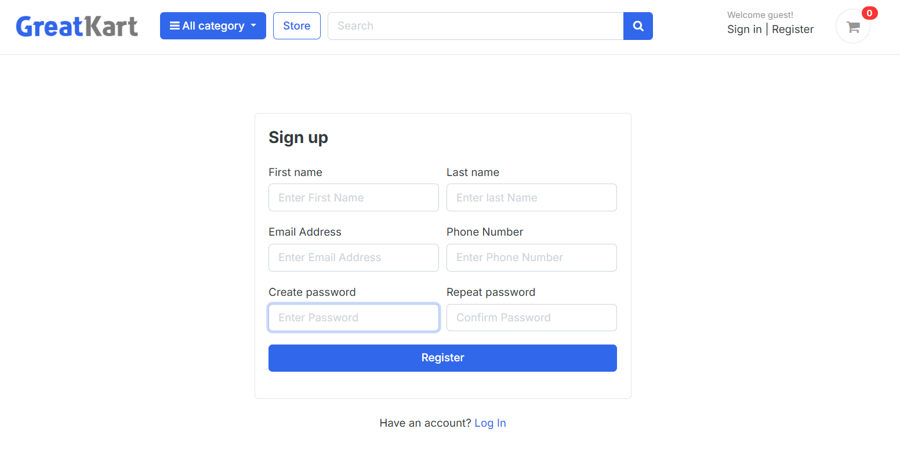
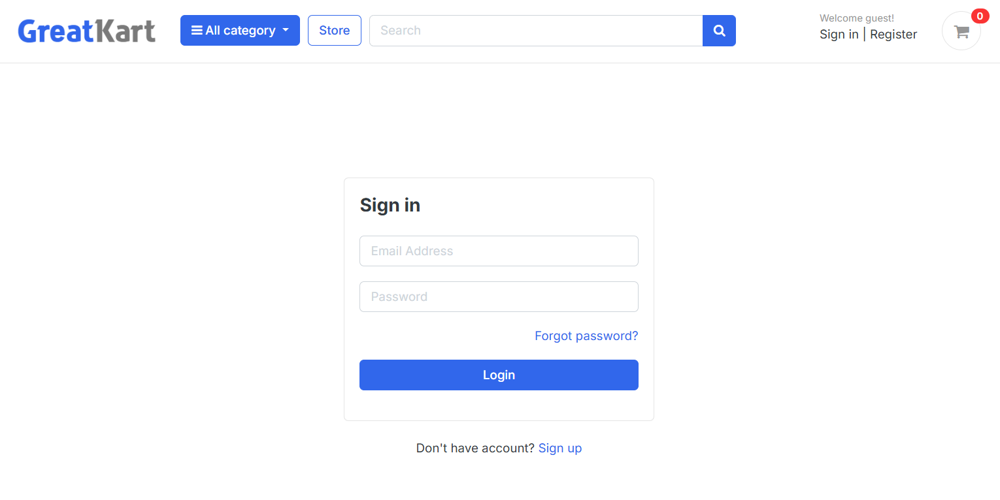
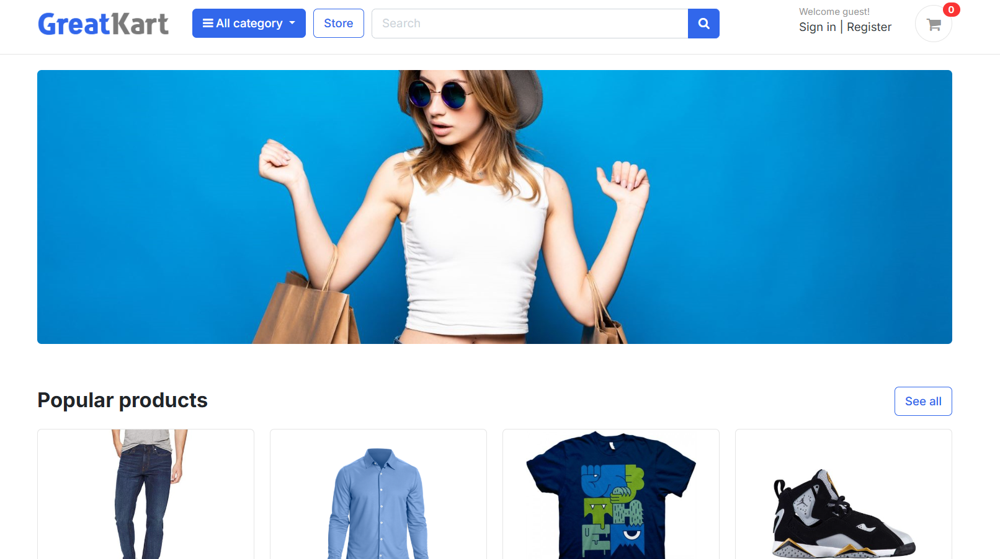
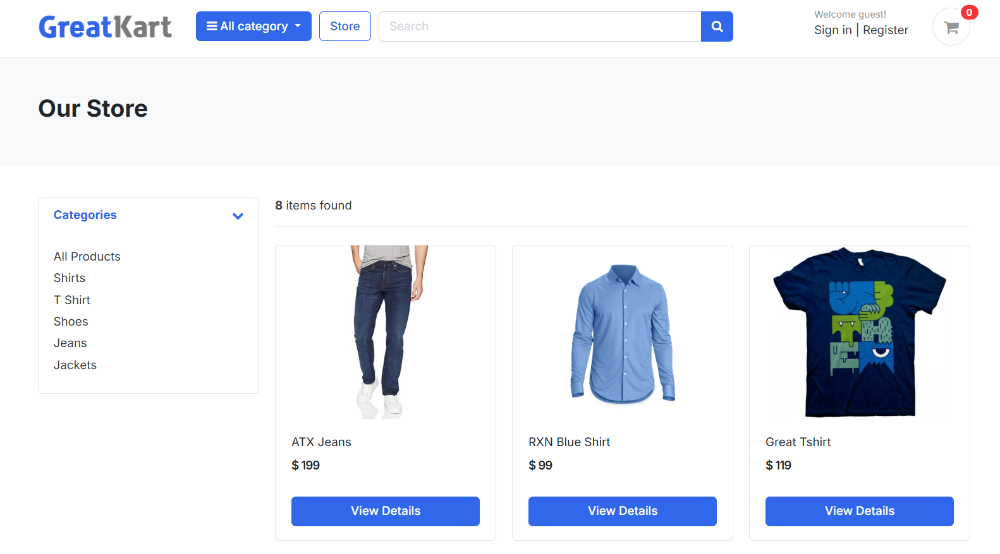
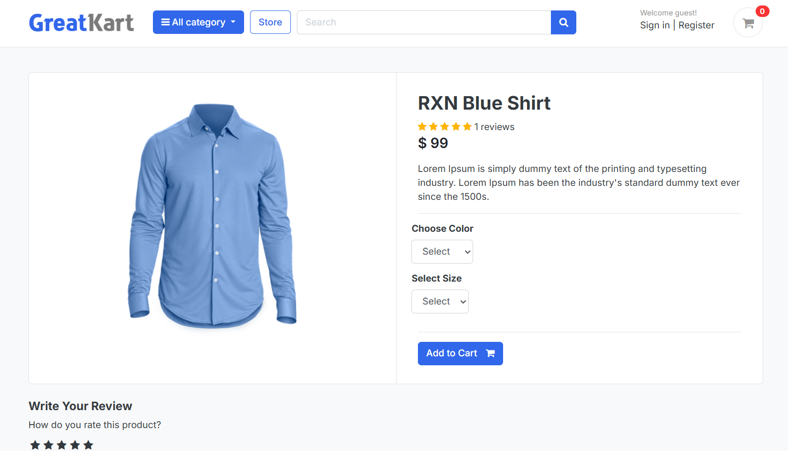
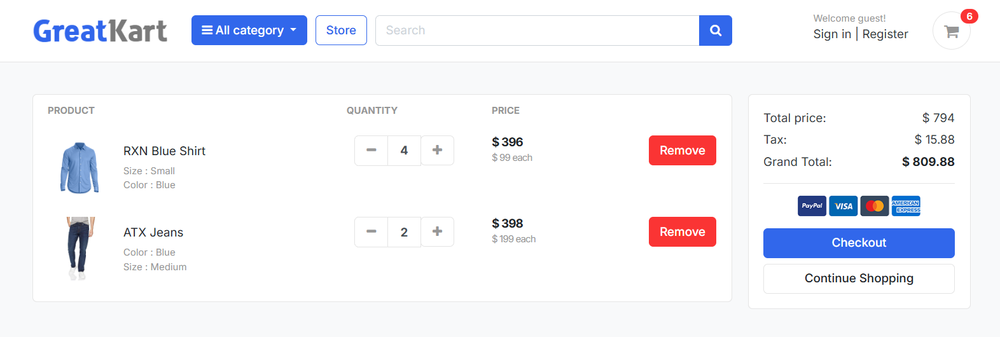

# 🛒 GreatKart – Django E-Commerce Web Application

<p align="center">
  
  
  
  
  
  
  
</p>

<h3 align="center">
🛍️ Browse Products • Shop Smart • Manage Your Cart
</h3>

<p align="center">
GreatKart is a full-stack e-commerce web application developed using Python and Django. It provides users with a platform to explore product categories, browse products, select product variations, and manage their shopping cart through a clean and user-friendly interface.
</p>

---

# 📚 Table of Contents

- Features
- Tech Stack
- Technical Highlights
- Project Preview
- Architecture
- Application Workflow
- Project Structure
- Installation
- Future Enhancements
- Learning Outcomes
- About the Developer

---

# 📌 Features

- 🔐 User Registration & Login
- 🔒 Django Authentication System
- 🛍️ Browse Products & Categories
- 🎨 Product Variations (Size & Color)
- 🛒 Add Products to Shopping Cart
- 🔢 Manage Cart Item Quantities
- ❌ Remove Products from Cart
- 🔍 Product Search Functionality
- 📦 Product Availability & Stock Status
- 🖥️ Django Admin Panel
- ⚡ CRUD Operations using Django ORM
- 📱 User-Friendly Web Interface

---

# 🛠️ Tech Stack

| Category | Technologies |
|----------|--------------|
| Backend | Python, Django |
| Frontend | HTML5, CSS3, JavaScript, Bootstrap |
| Database | SQLite |
| ORM | Django ORM |
| Authentication | Django Authentication |
| Version Control | Git & GitHub |

---

# 🚀 Technical Highlights

- Django Authentication System
- User Session Management
- Django ORM
- Database Model Relationships
- Product and Category Management
- Shopping Cart Management
- Product Variations Handling
- URL Routing
- Template Rendering
- Static & Media File Management
- MVC (MVT) Architecture
- Django Admin Customization

---

# 📸 Project Preview

## 🔐 User Registration & Login

| Register | Login |
|:---:|:---:|
|  |  |

---

## 🏠 Home Page

<p align="center">
  
</p>

---

## 📂 Product Categories

<p align="center">
  
</p>

---

## 🛍️ Product Details

<p align="center">
  
</p>

---

## 🛒 Shopping Cart

<p align="center">
  
</p>

---

# 🏗️ Architecture

```text
User
  │
  ▼
Browser
  │
  ▼
HTML • CSS • JavaScript • Bootstrap
  │
  ▼
Django URL Dispatcher
  │
  ▼
Views
  │
  ▼
Django ORM
  │
  ▼
SQLite Database
```

---

# 🔄 Application Workflow

```text
User Registration
       │
       ▼
User Login
       │
       ▼
Django Authentication
       │
       ▼
Access Store
       │
       ▼
Browse Categories
       │
       ▼
Explore Products
       │
       ▼
Select Size & Color
       │
       ▼
Add Product to Cart
       │
       ▼
Manage Cart Items
       │
       ▼
Update Quantity / Remove Items
       │
       ▼
View Shopping Cart
```

---

# 📂 Project Structure

```text
GreatKart/
│
├── accounts/
├── carts/
├── category/
├── orders/
├── store/
├── greatkart/
├── templates/
├── static/
├── media/
│   └── photos/
│       └── products/
│
├── .gitignore
├── manage.py
├── requirements.txt
└── README.md
```

---

# ⚙️ Installation

### 1. Clone the repository

```bash
git clone https://github.com/AkshaykumarSanti/GreatKart.git
```

### 2. Move into the project directory

```bash
cd GreatKart
```

### 3. Create a virtual environment

```bash
python -m venv venv
```

### 4. Activate virtual environment (Windows)

```bash
venv\Scripts\activate
```

### 5. Install dependencies

```bash
pip install -r requirements.txt
```

### 6. Apply database migrations

```bash
python manage.py migrate
```

### 7. Create admin user (optional)

```bash
python manage.py createsuperuser
```

### 8. Run the development server

```bash
python manage.py runserver
```

### 9. Open the application

```text
http://127.0.0.1:8000/
```

---

# 🚀 Future Enhancements

- Online Payment Gateway Integration
- Order Placement & Order History
- Order Tracking
- Email Notifications
- Wishlist Functionality
- Product Reviews & Ratings
- Automated Testing
- Cloud Deployment

---

# 📚 Learning Outcomes

Through this project, I gained practical experience in:

- Django Project Architecture
- User Authentication
- Session Management
- Django ORM
- Database Relationships
- Product and Category Management
- Shopping Cart Implementation
- Handling Product Variations
- CRUD Operations
- URL Routing
- Template Inheritance
- Bootstrap Grid System
- Responsive Web Design using Bootstrap
- Bootstrap Components
- Static & Media File Management
- Git & GitHub Version Control

---

# 👨‍💻 About the Developer

## Akshaykumar Santi

🎓 Bachelor of Engineering (Computer Science & Engineering)

🎯 CGPA: **9.13**

💻 Aspiring Software Developer passionate about Python, Django, SQL and Full-Stack Web Development.

### Technical Skills

- Python
- Django
- SQL
- HTML5
- CSS3
- JavaScript
- Bootstrap
- Git
- GitHub

Currently improving Data Structures & Algorithms while building real-world full-stack projects.

---

<p align="center">

⭐ If you found this project useful, consider giving it a Star.

Made with ❤️ using Python & Django.

</p>
